# Student Performance — End-to-End Analysis Pipeline

> Generated by `python run.py all` from UCI dataset 320 (Cortez & Silva, 2008).
> Two Portuguese secondary schools, two subjects, 1,044 student-subject records.

## 1. Executive summary

- **Task:** predict the final grade G3 (0–20) and the pass/fail outcome (G3 ≥ 10).
- **Headline finding:** the model with the best score is the least useful one.
  Using the two earlier grades lifts R² from **0.22** to
  **0.88**, but those grades only exist because the
  course is already two thirds over.
- **Honest baseline:** without any prior grades R² is **0.224**,
  MAE **2.44** points; pass/fail ROC AUC is
  **0.766** with F1 **0.861**.
- **Paired comparison:** 382 students appear in both files.
  Portuguese grades are **+2.13 points** higher on average
  (249 up, 95 down,
  38 tied; sign test p = 4.7e-17).
- **Cross-subject transfer:** a no-grade model trained on one subject loses
  up to 0.53 R² when applied to the other — the grade scale does not
  transfer as cleanly as a pooled model suggests.

## 2. Dataset and validation

Two files, identical schemas, 1,044 rows in total. Validation
runs 11 checks, including the 0–20 grade bounds and
the documented 1–5 questionnaire scales.

| Subject | Students | Mean G3 | SD | Pass rate | G3 = 0 | corr(G2, G3) |
| --- | --- | --- | --- | --- | --- | --- |
| Mathematics | 395 | 10.41 | 4.58 | 67.1% | 38 | 0.90 |
| Portuguese | 649 | 11.91 | 3.23 | 84.6% | 15 | 0.92 |

Notes that matter for every downstream number:

- **Zero grades are real.** 53 records end at exactly 0. They are
  students who dropped out or missed the final assessment, not corrupt cells, so they are
  kept and reported instead of being deleted.
- **Duplicate rows are kept.** 0 rows repeat every
  attribute and 382 rows repeat the pairing keys.
  Two students can genuinely share a demographic sheet; dropping them would delete people.
- **The merge keys are documented, not arbitrary.** The archive ships `student-merge.R`,
  which pairs on 13 attributes and yields **382** students. Joining on
  all 30 shared non-grade columns yields only
  **39** — see §5.

## 3. Cleaning

| Step | Result |
| --- | --- |
| Rows in | 1,044 |
| Rows out | 1,044 |
| Rows dropped | 0 (duplicate policy keeps genuine students) |
| Yes/no columns encoded | 8 (0/1) |
| Ordinal columns clipped to documented scales | 16 |
| Missing values | 0 |
| Pass rate | 78.0% |

Clipping is a guard rail, not a data edit: every value in the real files already sits
inside its documented range, and the clip only protects the pipeline against future
edits.

## 4. Exploratory findings

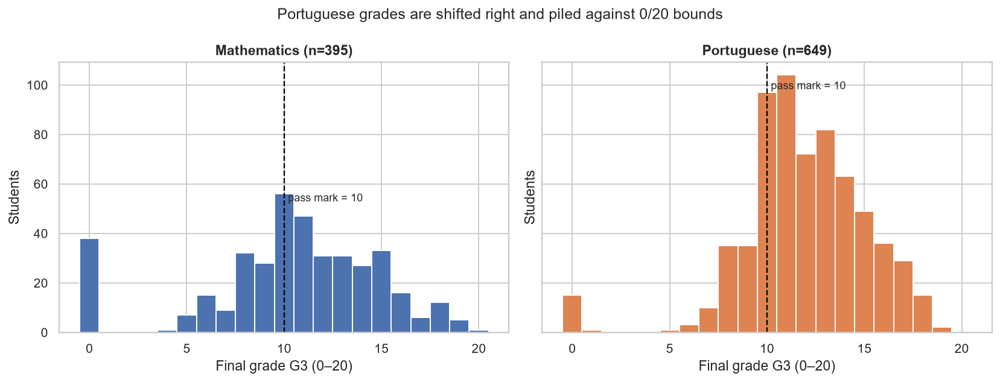

Portuguese grades are shifted right (mean 10.41
vs 11.91) and the pass rate
is far higher (67.1% vs
84.6%). Any pooled model
must be told which subject a row belongs to.

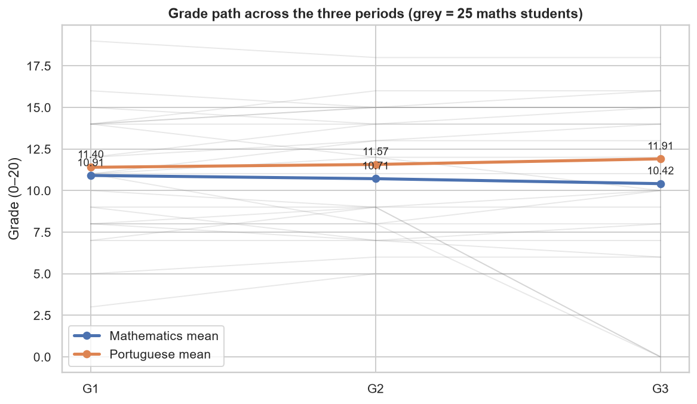

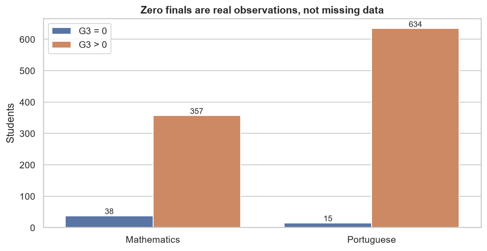

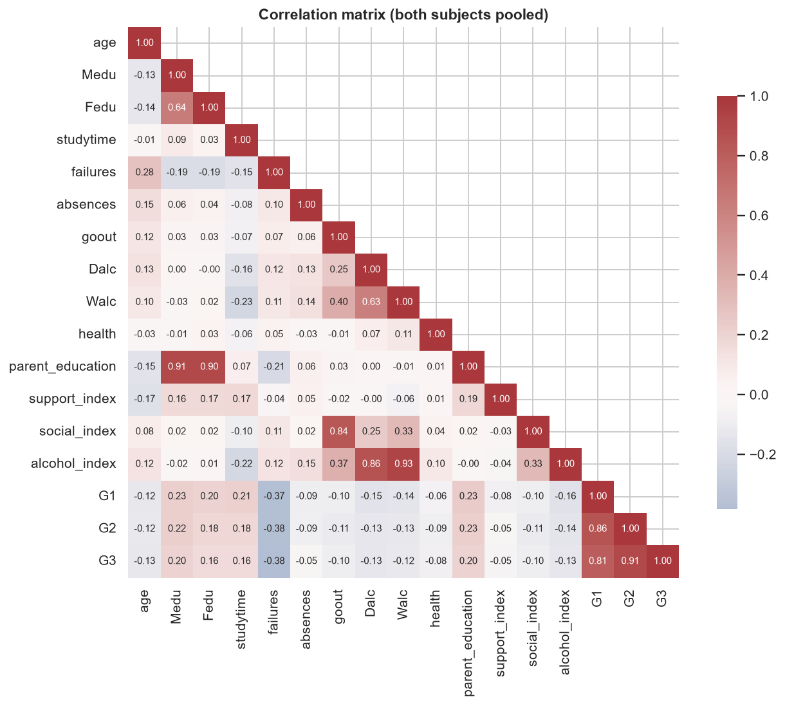

| Feature | Correlation with G3 |
| --- | --- |
| `G2` | +0.911 |
| `G1` | +0.809 |
| `failures` | -0.383 |
| `Medu` | +0.202 |
| `parent_education` | +0.200 |
| `studytime` | +0.162 |
| `Fedu` | +0.160 |
| `alcohol_index` | -0.134 |

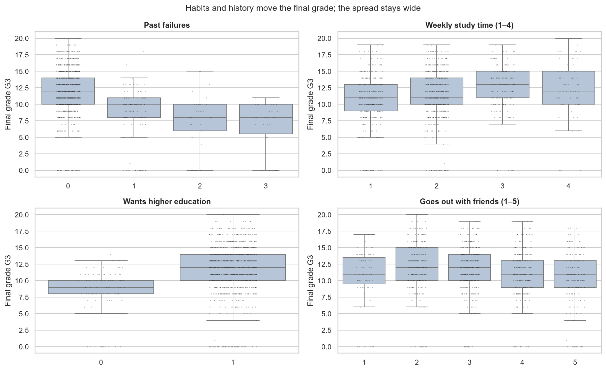

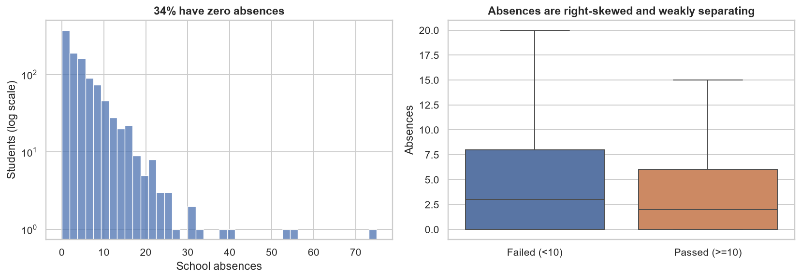

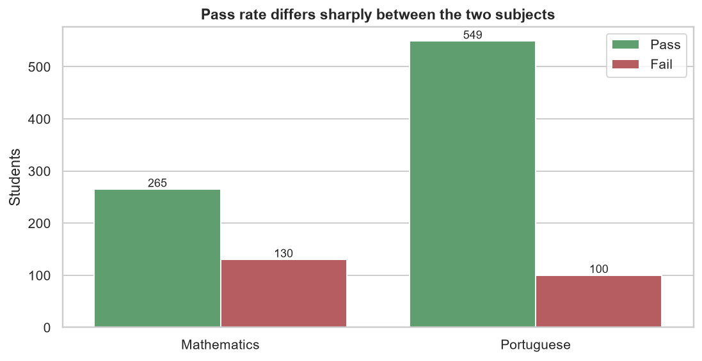

Past failures and the intention to continue to higher education separate the grades
most; absences are right-skewed (34%
of records report none) and only weakly informative once prior grades are available.

## 5. Pairing maths and Portuguese students

The archive's own R script is the specification: match on school, sex, age, address,
family size, parent status, parental education and jobs, reason, nursery and internet.

| Attempt | Keys | Matched students |
| --- | --- | --- |
| Documented `student-merge.R` | 13 | 382 |
| All shared non-grade columns | 30 | 39 |

Adding equality constraints can only shrink a join, and the 17 questionnaire items
(alcohol, going out, health) legitimately change between school years. The "safer"
merge throws away 90% of the matched students.

| Statistic | Value |
| --- | --- |
| Pairs | 382 |
| Maths mean G3 | 10.39 |
| Portuguese mean G3 | 12.52 |
| Mean paired difference | +2.13 |
| Median paired difference | +2.0 |
| Improved / worsened / tied | 249 / 95 / 38 |
| Exact sign test p | 4.7e-17 |
| Wilcoxon signed-rank p | 8.7e-21 |
| Paired effect size (Cohen's d) | 0.51 |
| Grade correlation across subjects | 0.48 |
| Pass rate maths / Portuguese | 66.8% / 91.6% |

The sign test is exact (binomial, ties discarded) and the Wilcoxon test makes no
normality assumption. Both agree: the Portuguese advantage is not sampling noise, but
the correlation of 0.48 shows a student's position in
the class is only partly stable across subjects.

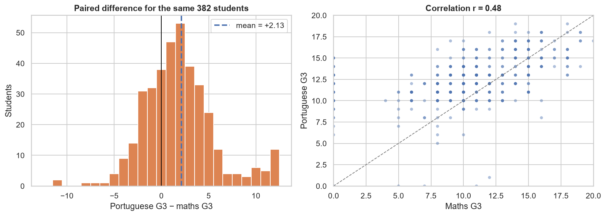

## 6. Modelling and the leakage problem

Three feature sets are fitted with identical preprocessing and tuning:

- `no_grades` — demographics, family, habits, absences (**usable at the start of term**);
- `with_g1` — adds the first-period grade;
- `with_g1_g2` — adds both earlier grades (**what most published results use**).

| Scenario | Regression R² | RMSE | Pass/fail AUC | F1 |
| --- | --- | --- | --- | --- |
| `no_grades` | 0.224 | 3.39 | 0.766 | 0.861 |
| `with_g1` | 0.843 | 1.53 | 0.943 | 0.948 |
| `with_g1_g2` | 0.876 | 1.36 | 0.959 | 0.927 |

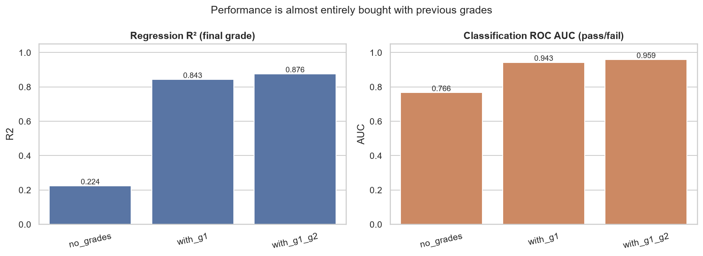

### 6.1 Primary (early-warning) model

| Metric | Value |
| --- | --- |
| Model | `random_forest` |
| R² | 0.224 |
| RMSE | 3.39 points |
| MAE | 2.44 points |
| Pass/fail ROC AUC | 0.766 |
| Pass/fail F1 | 0.861 |
| Precision / recall | 0.846 / 0.877 |
| Confusion (TN/FP/FN/TP) | 20/26/20/143 |

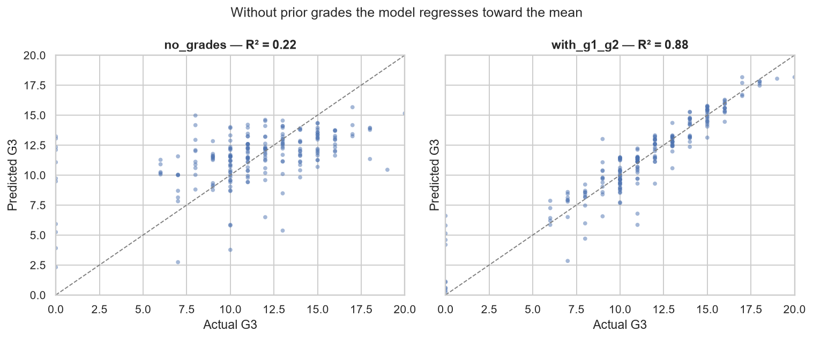

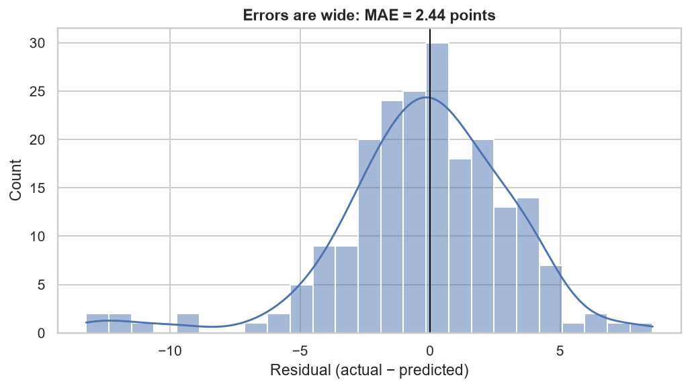

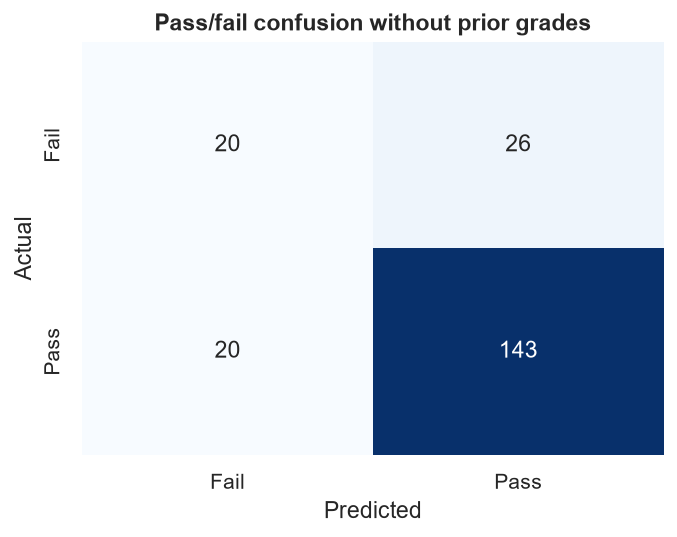

The no-grade model explains only about a fifth of the variance in final grades. That is
the honest ceiling for an early-warning system built on background and habit variables;
it ranks students usefully but cannot name an individual's grade.

### 6.2 Candidate comparison

**Regression (5-fold CV, R²)**

| Scenario | Model | R² | RMSE | MAE |
| --- | --- | --- | --- | --- |
| `no_grades` | random forest | 0.362 | 3.07 | 2.22 |
| `no_grades` | gradient boosting | 0.317 | 3.18 | 2.32 |
| `no_grades` | ridge | 0.229 | 3.38 | 2.47 |
| `with_g1` | random forest | 0.807 | 1.69 | 1.05 |
| `with_g1` | gradient boosting | 0.801 | 1.71 | 1.08 |
| `with_g1` | ridge | 0.772 | 1.84 | 1.23 |
| `with_g1_g2` | random forest | 0.855 | 1.45 | 0.88 |
| `with_g1_g2` | gradient boosting | 0.847 | 1.49 | 0.94 |
| `with_g1_g2` | ridge | 0.837 | 1.54 | 0.98 |

**Classification (5-fold CV)**

| Scenario | Model | ROC AUC | F1 | Recall |
| --- | --- | --- | --- | --- |
| `no_grades` | random forest | 0.814 | 0.869 | 0.902 |
| `no_grades` | gradient boosting | 0.785 | 0.866 | 0.900 |
| `no_grades` | logistic regression | 0.782 | 0.816 | 0.756 |
| `with_g1` | gradient boosting | 0.963 | 0.941 | 0.949 |
| `with_g1` | logistic regression | 0.959 | 0.929 | 0.900 |
| `with_g1` | random forest | 0.943 | 0.927 | 0.931 |
| `with_g1_g2` | random forest | 0.975 | 0.953 | 0.937 |
| `with_g1_g2` | logistic regression | 0.972 | 0.934 | 0.908 |
| `with_g1_g2` | gradient boosting | 0.970 | 0.946 | 0.954 |

### 6.3 Cross-subject transfer

Train on one subject with no grades, predict the other:

| Direction | R² | MAE | ROC AUC | F1 |
| --- | --- | --- | --- | --- |
| mat → por | -0.304 | 2.81 | 0.691 | 0.823 |
| por → mat | 0.100 | 3.10 | 0.616 | 0.809 |

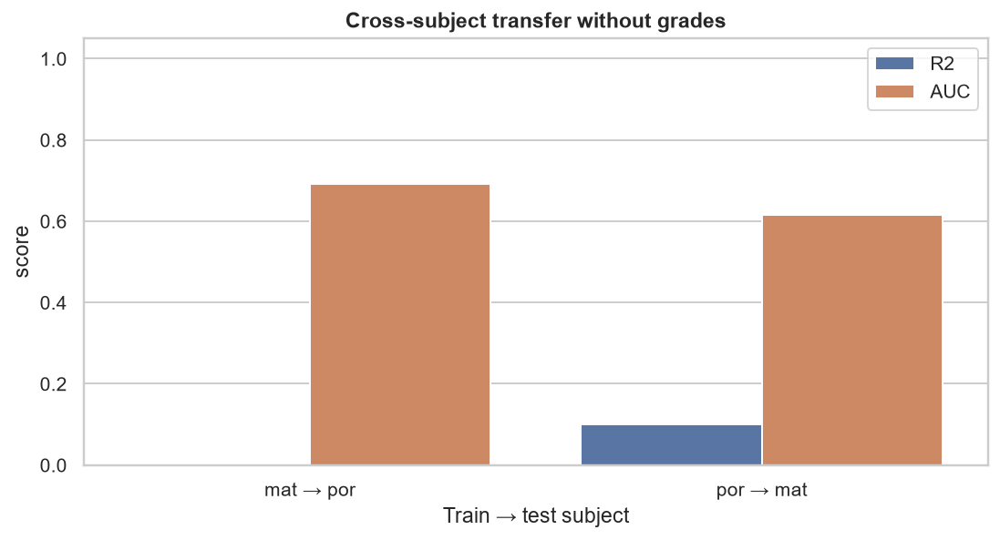

Transfer is weaker than within-subject performance. Subject identity is not a nuisance
variable to be averaged away; it encodes a different grading distribution.

### 6.4 What the early-warning model leans on

| Feature | Importance |
| --- | --- |
| `failures` | 0.2006 |
| `absences` | 0.0761 |
| `absence_flag` | 0.0517 |
| `study_balance` | 0.0334 |
| `parent_education` | 0.0321 |
| `health` | 0.0272 |
| `age` | 0.0256 |
| `social_index` | 0.0254 |
| `subject_por` | 0.0252 |
| `alcohol_index` | 0.0239 |

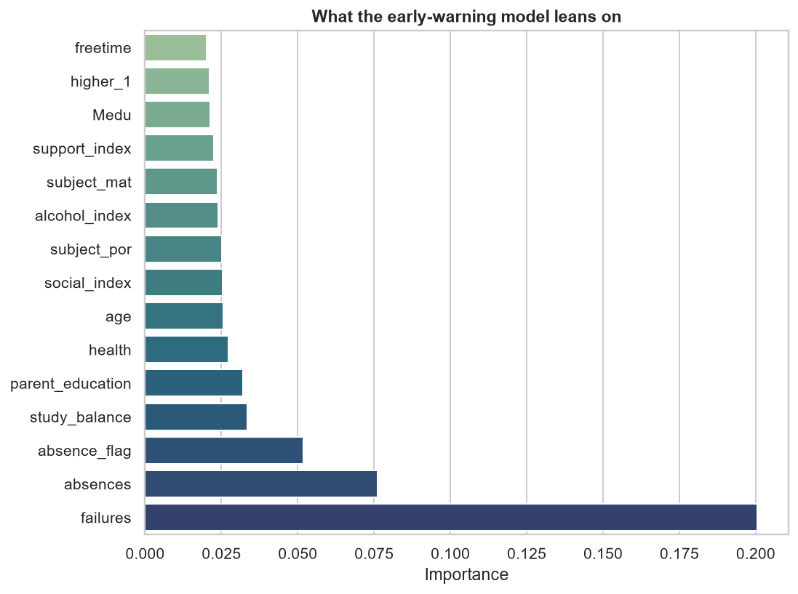

## 7. Interpretation and limitations

1. **Grades are both signal and leakage.** G1/G2 predict G3 extremely well because they
   measure the same thing a few months earlier. Reporting only the high-R² variant hides
   that the system cannot act before those grades exist.
2. **The Portuguese advantage survives pairing.** Mean +2.13
   points across 382 students, p ≈ 5e-17.
   Plausible causes (grading standards, syllabus difficulty, class composition) cannot be
   separated with these columns.
3. **Small n, wide intervals.** 1,044 records across two schools; subgroup estimates have
   wide confidence intervals and the two school identifiers are anonymous.
4. **Zero finals are structural.** A model that predicts pass/fail should be evaluated on
   its ability to flag the 53 zero-grade students early, which is
   precisely where recall matters and precision is low.
5. **No causal claims.** Study time correlates with grades, but motivation drives both.
6. **Privacy.** The data are anonymised, but combination attacks on rare attribute
   profiles are theoretically possible; no individual-level predictions are published.

## 8. Reproducing

```bash
pip install -r requirements.txt
python run.py all
```

Regenerates every figure, `reports/metrics.json`, this report and the model card. The
notebook is built with `python scripts/build_notebook.py`.
